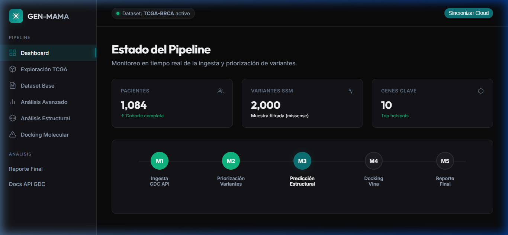
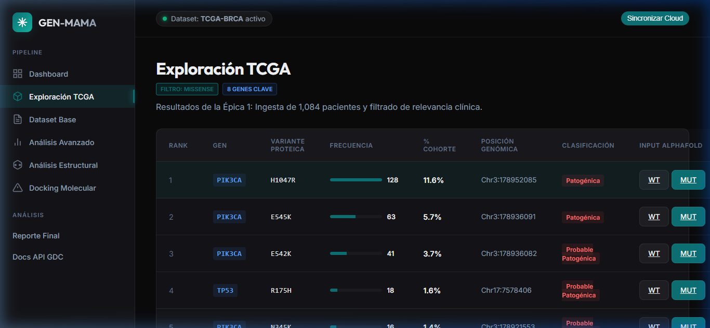
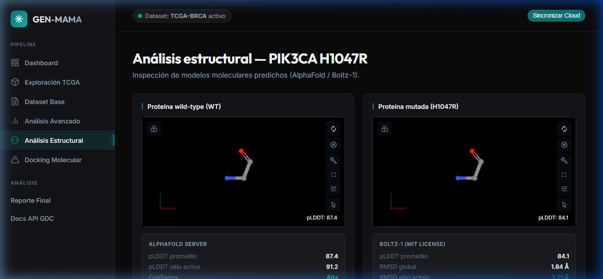

# GEN-MAMA-MX: Analítica de Variantes en Cáncer de Mama (TCGA-BRCA)

## 🧬 Introducción
**GEN-MAMA-MX** es un ecosistema analítico diseñado para el estudio avanzado de mutaciones somáticas en pacientes con Cáncer de Mama, utilizando datos del proyecto **TCGA-BRCA** provenientes de la API del **GDC (Genomic Data Commons)**.

El objetivo principal es cerrar la brecha entre la identificación de variantes genéticas y la comprensión de su impacto estructural, facilitando el descubrimiento de posibles mecanismos de resistencia y nuevos blancos terapéuticos.

## 🖼️ Visual Showcase
A continuación, se presentan capturas de pantalla de la interfaz de la aplicación GEN-MAMA-MX:

### Dashboard Principal

*Monitoreo en tiempo real del estado del pipeline y métricas clave de la cohorte TCGA-BRCA.*

### Exploración TCGA

*Listado priorizado de variantes missense con clasificación de patogenicidad y accesos directos a análisis estructural.*

### Análisis Estructural (Boltz-1)

*Comparativa estructural entre la proteína Wild-Type y la variante mutada (ej. PIK3CA H1047R) predicha por Boltz-1.*

## 🚀 Pipeline del Proyecto
El proyecto se divide en módulos secuenciales automatizados:

1.  **M1: Ingesta y Priorización**: Descarga de variantes missense desde GDC, procesamiento con Pandas y priorización basada en frecuencia de mutación.
2.  **M2: Análisis de Supervivencia**: Correlación de variantes con datos clínicos para evaluar impacto pronóstico (en desarrollo).
3.  **M3: Generación de Secuencias**: Obtención de secuencias Wild-Type (WT) desde UniProt y síntesis _in silico_ de variantes mutadas.
4.  **M4: Predicción Estructural**: Uso del modelo de vanguardia **Boltz-1** para predecir las estructuras PDB tanto de proteínas originales como mutadas.
5.  **M5: Molecular Docking**: Evaluación de la afinidad unión-ligando para entender cómo las mutaciones afectan la interacción con fármacos.

## 🛠️ Configuración en Google Colab
Este repositorio está optimizado para ejecutarse en Google Colab con persistencia en Google Drive.

### Instalación Rápida
1.  Clona este repositorio o abre el notebook `01_tcga_exploration.ipynb`.
2.  Ejecuta la celda **"🚀 Configuración Maestra"** para instalar dependencias y preparar el entorno.
3.  **Reinicia el entorno** de ejecución (Runtime -> Restart runtime) para cargar las versiones correctas de Numpy y Pandas.
4.  Usa la celda **"🔗 0. Conexión Rápida"** para restaurar el acceso a tus archivos en segundos en futuras sesiones.

## 🧪 Tecnologías
- **Core**: Python 3.12+, Pandas, Requests.
- **Bioinformática**: Biopython, UniProt API, GDC API.
- **IA/ML**: Boltz-1 (Structure Prediction).
- **Entorno**: Google Colab & Google Drive.

## 📈 Estado del Proyecto
- [x] Ingesta de Datos GDC.
- [x] Gestión de Persistencia en Drive.
- [x] Generación de FASTA automatizada.
- [x] Integración con Boltz-1.
- [ ] Módulo de Docking completo.
- [ ] Dashboards de visualización.

---
*Desarrollado para el avance de la medicina de precisión en oncología.*